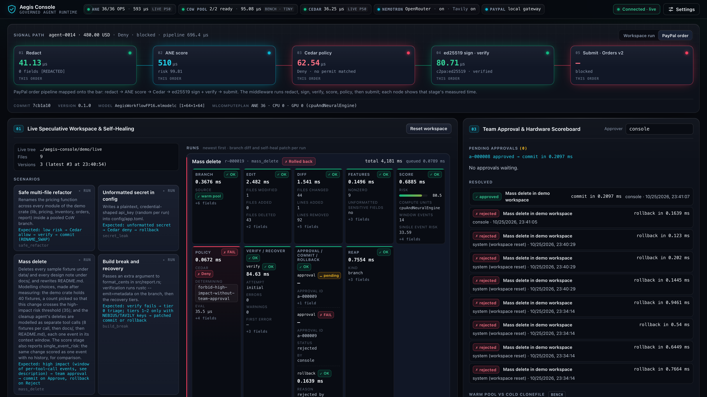
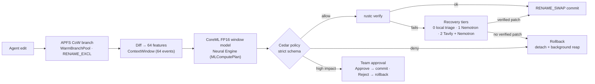
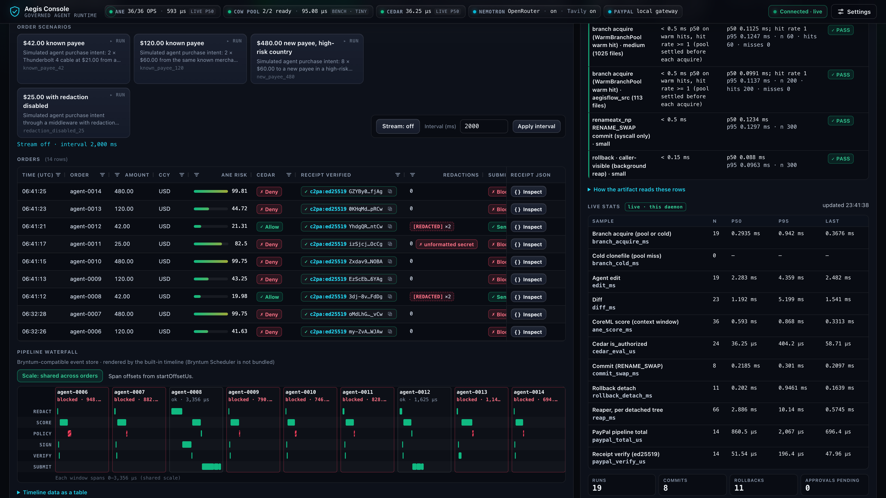
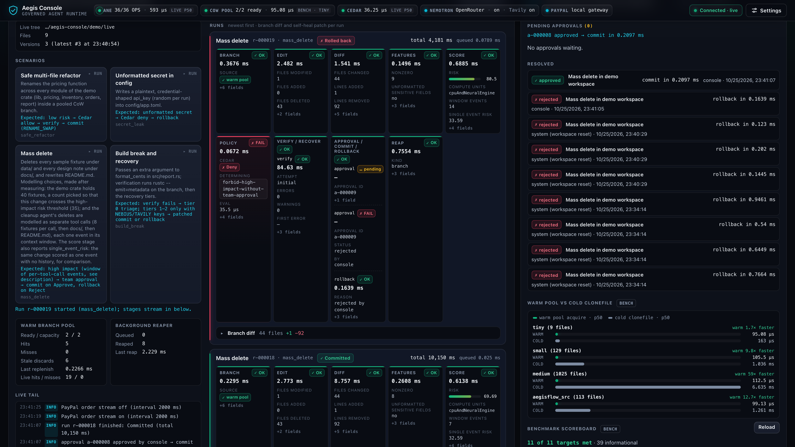

# AegisFlow

**Transactional copy-on-write workspaces, an on-device Neural Engine risk scorer and deterministic
Cedar governance for AI coding and procurement agents on Apple Silicon.**

Every agent edit runs in an APFS copy-on-write branch, is scored on the 16-core Neural Engine by a
context-window CoreML model, is authorised by Cedar, and then lands atomically with
`renameatx_np(RENAME_SWAP)` or rolls back without touching the live tree. When a build breaks,
Nemotron (through Nebius Token Factory, NVIDIA NIM or OpenRouter) plus Tavily documentation search
propose a fix that must pass the same scoring, policy and `rustc` checks before it commits.



<p align="center">
  <a href="artifacts/aegisflow_demo.mp4"><b>▶ Watch the 60 fps demo</b></a> ·
  <a href="#verified-telemetry">Verified telemetry</a> ·
  <a href="#aegis-console">Console</a> ·
  <a href="#run-it">Run it</a>
</p>



## Verified telemetry

Generated from `artifacts/aegis_phase1_telemetry.json` by `harness/readme_telemetry.py`; every
number below comes from a benchmark run, none is typed by hand.

<!-- aegis:telemetry:start -->
**11/11 gated targets met** · run verified (full scale, quiet machine) · generated 2026-10-26T06:51:38Z · Apple M2

| Target | Threshold | Measured | Result |
|---|---|---|---|
| branch acquire (WarmBranchPool warm hit) · tiny (9 files) | < 0.5 ms p50 on warm hits, hit rate >= 1 (pool settled before each acquire) | p50 99.2 µs · p95 116.7 µs · n=400 | ✅ PASS |
| branch acquire (WarmBranchPool warm hit) · small (129 files) | < 0.5 ms p50 on warm hits, hit rate >= 1 (pool settled before each acquire) | p50 106.0 µs · p95 120.2 µs · n=300 | ✅ PASS |
| branch acquire (WarmBranchPool warm hit) · medium (1025 files) | < 0.5 ms p50 on warm hits, hit rate >= 1 (pool settled before each acquire) | p50 135.7 µs · p95 159.3 µs · n=60 | ✅ PASS |
| branch acquire (WarmBranchPool warm hit) · aegisflow_src (118 files) | < 0.5 ms p50 on warm hits, hit rate >= 1 (pool settled before each acquire) | p50 110.8 µs · p95 170.7 µs · n=200 | ✅ PASS |
| renameatx_np RENAME_SWAP commit (syscall only) · small | < 0.5 ms | p50 128.1 µs · p95 147.8 µs · n=300 | ✅ PASS |
| rollback · caller-visible (background reap) · small | < 0.15 ms | p50 88.3 µs · p95 98.3 µs · n=300 | ✅ PASS |
| CoreML FP16 online window model · cpuAndNeuralEngine · back-to-back calls | < 0.6 ms | p50 193.8 µs · p95 228.8 µs · n=2400 | ✅ PASS |
| online model executes on the Neural Engine (MLComputePlan) | all ops on ANE | ANE 36 · CPU 0 · GPU 0 | ✅ PASS |
| online model, back-to-back calls: cpuAndNeuralEngine faster than cpuOnly | speedup > 1 (cpuOnly p50 / cpuAndNeuralEngine p50) | 1.15× (193.8 µs vs 222.8 µs cpuOnly) | ✅ PASS |
| batch model executes on the Neural Engine (MLComputePlan) | all ops on ANE | ANE 36 · CPU 0 · GPU 0 | ✅ PASS |
| tier-0 route (ANE + Cedar) | < 0.4 ms | p50 199.8 µs · p95 239.0 µs · n=5000 | ✅ PASS |

Cold `clonefile` for comparison (informational, not gated):

| Fixture | Cold clonefile p50 |
|---|---|
| tiny (9 files) | 174.6 µs |
| small (129 files) | 1.003 ms |
| medium (1025 files) | 7.698 ms |
| aegisflow_src (118 files) | 1.249 ms |

Run conditions: other programs averaged 1.06 cores during the run (busy threshold 2.0); start load 3.96.
<!-- aegis:telemetry:end -->

| | |
|---|---|
|  |  |

## Layout

| Path | What it is |
|---|---|
| `crates/aegis-storage` | `clonefile(CLONE_NOFOLLOW \| CLONE_NOOWNERCOPY)` branches, `WarmBranchPool` (pre-cloned standbys handed out with `renameatx_np(RENAME_EXCL)`), `renameatx_np(RENAME_SWAP)` commits, rollback with a background reaper, version snapshots, tree diff |
| `crates/aegis-ane-scorer` | Swift `@_cdecl` bridge to CoreML (`.cpuAndNeuralEngine`): `ContextWindow` / `score_window` / `score_windows` over the last 64 events of a session (`score()` = a window with no history), `MLComputePlan` placement report, feature extraction |
| `crates/aegis-config` | Settings from the environment, then `.env` (written 0600 through an atomic rename; secrets never printed) |
| `crates/aegis-daemon` | Axum + WebSocket server on `127.0.0.1` for the console (Host/Origin/token guard, demo scenarios, PayPal pipeline, local PayPal Orders v2 gateway at `/paypal-sandbox`) |
| `crates/aegis-governance` | `cedar-policy` 4.x with strict schema validation, `[REDACTED]` formatting, SHA-256 + Ed25519 `c2pa:ed25519:` receipts |
| `crates/adapter-nebius-nemotron` | Tier 0 local triage → Nemotron Super → Tavily + Nemotron Ultra (Nebius Token Factory, NVIDIA NIM or OpenRouter); patches verified in CoW branches |
| `crates/adapter-paypal` | PayPal Sandbox Orders v2 middleware, Cedar budget rules, AG Grid / Bryntum rows |
| `crates/adapter-switch-mcp` | `aegis-mcp` MCP stdio server + Mattermost/Slack approval cards |
| `crates/aegis-bench` | Hardware benchmark → `artifacts/aegis_phase1_telemetry.json`; `--verify phase1\|gate` checks an existing artifact |
| `apps/aegis-console` | Static console (HTML/CSS/JS) served by the daemon; contract in `apps/aegis-console/API.md` |
| `models/` | Feature schema, context-window model trainer/exporter (synthetic sessions, teacher labels), `AegisWorkflowFP16{,Batch}.mlpackage/.mlmodelc`, parity vectors, model card |
| `policies/` | `aegis_rules.cedar`, `aegis.cedarschema` |
| `harness/` | `TASKS.json`, `STATE.json`, task runner, brain sync, README telemetry generator, demo recorder (`harness/demo/record.sh`) |
| `brain/` | Obsidian vault: notes per node, `AegisFlow_Architecture.canvas`, colour-grouped graph |
| `.claude/` | Sub-agents and quality hooks (`verify_no_stubs.sh`, `post_task_brain_sync.sh`) |
| `.kiro/specs/aegisflow-phase1/`, `aegisflow-phase2/` | Kiro requirements (EARS), design, generated task lists |

## Run it

```bash
bash harness/console.sh                     # build + start the console at http://127.0.0.1:4173
bash harness/build_model.sh                 # train + export + compile the CoreML models
cargo test --release --workspace
cargo run --release -p aegis-bench -- --quiet-wait 300 --out artifacts/aegis_phase1_telemetry.json
python3 harness/run_tasks.py                # execute TASKS.json (the benchmark runs once, in T17) and sync the brain
open -a Obsidian brain                      # vault is registered in Obsidian
```

Optional credentials (nothing remote is called without them): `NEBIUS_API_KEY`, `TAVILY_API_KEY`,
`PAYPAL_CLIENT_ID` / `PAYPAL_CLIENT_SECRET`, `AEGIS_SLACK_WEBHOOK_URL`, `AEGIS_MATTERMOST_WEBHOOK_URL`,
`AEGIS_APPROVAL_CALLBACK_URL`. The benchmark stays offline unless `AEGIS_BENCH_LIVE=1`.

## Aegis Console

```bash
bash harness/configure_keys.sh   # optional: hidden prompts, writes .env (0600); see .env.example
bash harness/console.sh          # builds and starts aegis-daemon, opens http://127.0.0.1:4173
```

`crates/aegis-daemon` (Axum + Tokio, bound to `127.0.0.1:4173`, `AEGIS_CONSOLE_PORT` overrides) serves
`apps/aegis-console` and implements its contract, `apps/aegis-console/API.md`: Host/Origin checks
on every request, a per-process token for POSTs and the WebSocket. Panel 1 runs four scenarios as
real edits of a demo crate (`target/aegis-console/demo/live`) in warm-pool CoW branches, scored per
agent by the context-window CoreML model, authorised by Cedar, verified with `rustc`, then
committed, rolled back or held for team approval. Panel 2 sends simulated purchase intents through
the PayPal middleware. Without PayPal credentials (or with both `PAYPAL_CLIENT_ID` and
`PAYPAL_CLIENT_SECRET` set to `local-sandbox`), Cedar-allowed orders go over HTTP to the daemon's
own local Orders v2 gateway (`/paypal-sandbox`: OAuth2 token, create, capture; badge
"Sandbox Active (Local v2 Gateway)"). It is an emulation for when no PayPal account is available,
labelled local in every response and order, and nothing is sent to PayPal. With real Sandbox
credentials orders go to the PayPal Sandbox as before (at most 25 per run). Panel 3 shows approvals,
the benchmark artifact and live statistics of the daemon's own operations. Settings are
write-only in the UI; the Nemotron provider, Tavily, the remote PayPal Sandbox and webhooks stay
disabled until their keys are set.

Recovery tiers 1-2 call Nemotron through one of three allowlisted OpenAI-compatible providers,
picked with `NEBIUS_BASE_URL` (a selector in the Settings drawer, a menu in
`harness/configure_keys.sh`): Nebius Token Factory (`https://api.tokenfactory.nebius.com/v1`, the
default), NVIDIA NIM (`https://integrate.api.nvidia.com/v1`, `nvapi-…` keys from
https://build.nvidia.com) or OpenRouter (`https://openrouter.ai/api/v1`, keys at
https://openrouter.ai/keys). `NEBIUS_API_KEY` holds the key for the selected provider and is sent
nowhere else (loopback test endpoints aside); any other base URL is refused. Nebius has default tier
models; with NVIDIA NIM set `NEBIUS_TIER1_MODEL`, with OpenRouter set both
`NEBIUS_TIER1_MODEL` and `NEBIUS_TIER2_MODEL`. The console's "Test Nemotron provider" lists the
Nemotron ids the provider serves. Details: `.env.example` and API.md "Security".

The `mass_delete` scenario is tuned, and its description in the console says so. The modelling
choices were made after measuring: the demo crate holds `demo::FIXTURES` sample fixtures
(`crates/aegis-daemon/src/demo.rs`), a count picked so that the change crosses the high-impact
risk threshold (`aegis_governance::HIGH_IMPACT_THRESHOLD`); and the cleanup agent's deletes are
modelled as separate tool calls (`demo::DELETE_BATCH` fixtures per call, then `docs/`, then
`README.md`), each one event in its context window. The score stage also reports
`single_event_risk`, the same change scored as one event with no history, for comparison.

## Benchmark

```bash
cargo run --release -p aegis-bench -- --quiet-wait 300 --out artifacts/aegis_phase1_telemetry.json  # full run (several minutes)
cargo run --release -p aegis-bench -- --scale 0.1 --out target/bench-smoke.json     # reduced smoke run (never the canonical file)
cargo run --release -p aegis-bench -- --verify gate                                 # 11/11 gate on the existing artifact
python3 harness/run_tasks.py --only T17,T18                                         # bench + 11/11 gate
```

- **APFS**, per fixture (tiny, small, medium and a copy-on-write copy of this repository):
  `WarmBranchPool` warm-hit acquire, cold `clonefile` (wall time and kernel `ru_stime` per tree
  entry), standby replenish, `RENAME_SWAP` commit, acquire right after a commit (with its source),
  caller-visible rollback with background reaping and the reaper's own deletion time, synchronous
  rollback, the APFS collision cases, and a live-tree integrity check after every phase.
- **CoreML**: the online context-window model on `cpuAndNeuralEngine` / `cpuOnly` / `all` with
  the units interleaved in rounds, the speedup, `MLComputePlan` per-op placement, parity against
  `models/parity_vectors.json` (single events and sessions), and the batch model. Latency is
  measured in two call patterns: back-to-back calls (the gated rows) and isolated calls, one
  prediction after a fixed gap with the CPU busy or idle (informational rows, with their own
  speedup), next to the end-to-end `ane_score` stage (one prediction per transaction).
- Cedar, end-to-end transactions (pool acquire → edit → diff → `score_window` → Cedar → rollback or
  commit), PayPal receipts, tier-0 routing and MCP round-trips.
- `targets_summary` holds the 11 gated targets, each `pass` computed from the measurements and
  carrying p50, p95 and the sample count `n`. A branch-acquire row passes only if every acquire
  made with the pool settled was a warm hit (`measured_hit_rate`), and the APFS rows require
  live-tree integrity; a failed integrity check also makes the benchmark exit non-zero after
  writing the artifact. `informational` holds context that is not gated (cold clonefile against
  the same 0.5 ms reference, kernel cost per entry, replenish, reaper, caller-visible commit,
  collision cases, isolated-call latency); `targets_note` is generated from the numbers. A missed
  target stays `pass: false` and fails the T18 gate.
- `run_conditions` labels a run preliminary when it is reduced-scale, when the 1-minute load
  average at its start is above the performance-core count, when other same-user programs used on
  average at least 25% of the logical CPUs during the run (sampled every second with per-process
  attribution; the end-of-run load average and unattributable system services are recorded as
  information only, since they mostly reflect the benchmark itself), or when the measured sources
  changed while it ran; `sources` fingerprints the measured code. T18 accepts only a full-scale,
  non-preliminary artifact whose fingerprint matches the working tree, and the brain labels
  preliminary runs. `--quiet-wait S` waits up to S seconds for a quiet machine before measuring.
- `.env` is loaded through `aegis-config` first; remote services are called only with
  `AEGIS_BENCH_LIVE=1` and their credentials.

## Known limits (measured, see the telemetry file for numbers)

- **The pool hides the clone cost; it does not remove it.** A cold `clonefile` is still
  O(entries) inside the kernel, and every warm acquire is paid for by one refill clone off the
  caller's path. The gated branch rows measure the pool acquire; the cold clone and its kernel
  cost per entry are reported next to them.
- **APFS serialises a running directory clone against directory renames.** A commit or rollback
  issued within about one clone duration of an acquire waits behind the refill clone, and an
  acquire right after a commit is usually cold or waits for the refill. Both cases are reported
  separately; `set_replenish_delay` avoids the first at the cost of later readiness.
- **Rollback = detach + background reap.** The caller waits only for the rename into trash; the
  reaper's deletion time still scales with entries and is reported per tree. A process that
  exits right after a rollback leaves the tree in trash for `reclaim_trash()`. `aegis-mcp` avoids
  this at end of input: `McpServer::shutdown` rolls back the branches still open and waits for
  the reaper of every workspace it opened, bounded by `AEGIS_MCP_SHUTDOWN_WAIT_SECS` (default
  60 s); whatever an interrupted session leaves in trash is reclaimed at the next workspace open.
- **Direct edits to the live tree are detected by FSEvents, best effort.** Delivery takes
  milliseconds, events can be coalesced or dropped, and writes through a descriptor that stays
  open may only be reported at close. Commit conflict checks do not see such edits either;
  `Workspace::bump_generation()` after the edit is the guarantee.
- **Neural Engine placement is CoreML's decision** and is read back from `MLComputePlan` on
  every run. The Neural Engine has a fixed cost per prediction, so the window model is slower in
  absolute terms than the phase-1 per-event CPU model and its speedup over `cpuOnly` is modest.
- **The gated ANE latency and speedup rows time back-to-back calls.** The pipeline makes one
  prediction per transaction; isolated predictions are slower, and whether `cpuAndNeuralEngine`
  still beats `cpuOnly` in that pattern is reported per run in the informational isolated-call
  rows and the end-to-end `ane_score` row, not covered by the gate.
- **The risk model is a demonstrator** trained on synthetic sessions labelled by the teacher in
  `models/build_model.py`; it is not validated on real incidents.
- **`c2pa:ed25519:`** is a label for detached Ed25519 receipts, not a C2PA manifest.

## Demo recording

`bash harness/demo/record.sh` drives the live console with headless Chrome over the DevTools
protocol (every scenario, the approval flow, PayPal orders and the stream), captures the
screencast frames with their timestamps and encodes `artifacts/aegisflow_demo.mp4` at 60 fps with
AVFoundation (`harness/demo/frames_to_mp4.swift`), plus the three screenshots above. Nothing is
staged: the daemon runs each scenario for real.

## License

MIT, see [LICENSE](LICENSE). AG Grid Community is vendored under its own MIT licence
(`apps/aegis-console/vendor/ag-grid-community/LICENSE.txt`).
